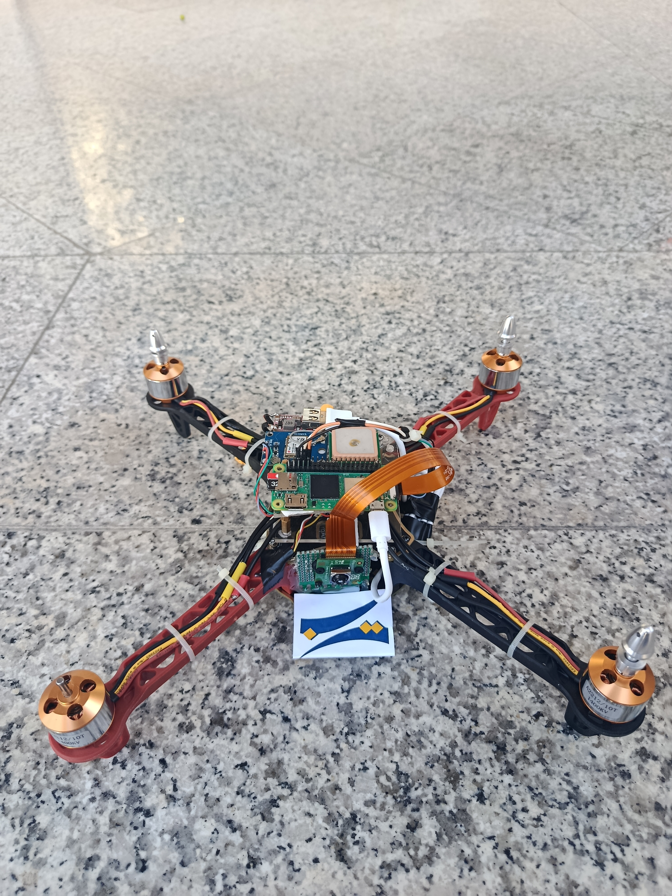
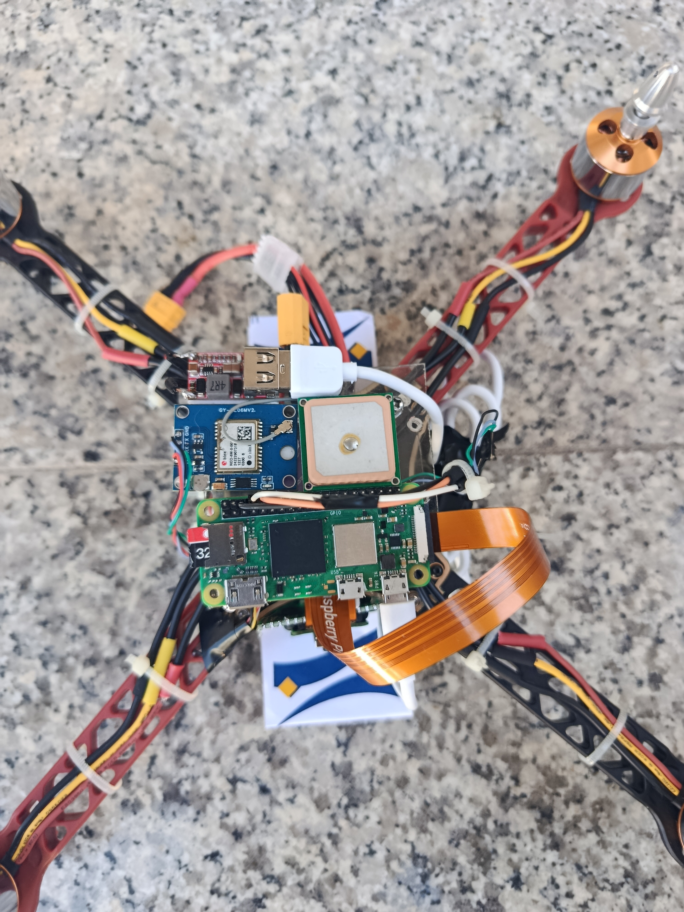
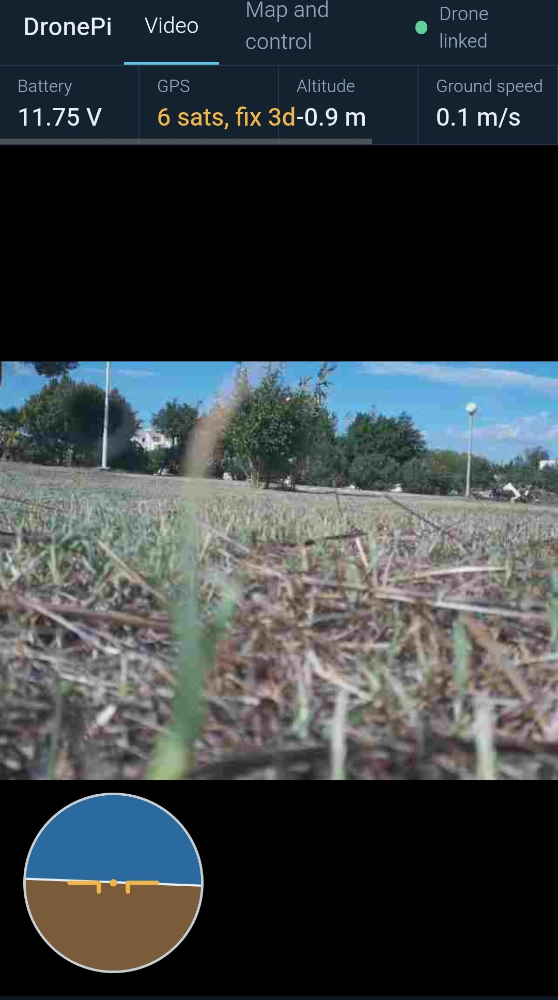
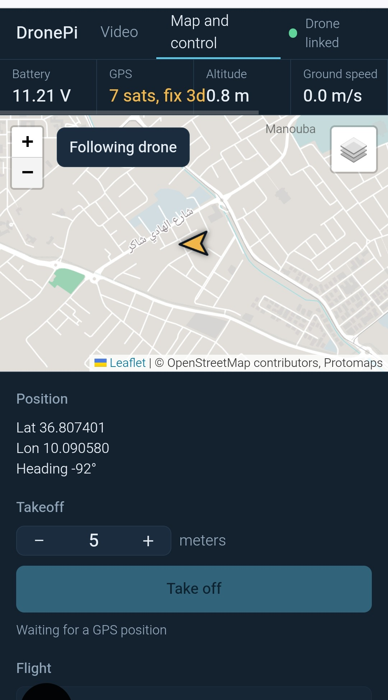

# DronePi



A quadcopter with a Raspberry Pi companion computer and a web ground station that runs on the Pi itself. The Pi creates its own Wi-Fi hotspot, so a phone or laptop can watch the live camera, follow the drone on an offline map of Tunisia, and send simple commands, with no internet and no SSH session needed in the field.

The project is carried out in collaboration with **La Poste Tunisienne**.


> **Safety.** This is a flying machine. Remove the propellers for every bench test, keep a bound radio transmitter as a manual override, and fly only in an open area. Software commands from the web page are not a replacement for a pilot.

---

## Demonstration video

Watch the project demonstration on YouTube:

<a href="https://www.youtube.com/shorts/Cy97sNL5oDs"></a>

---

## Hardware



| Part | Details |
| --- | --- |
| Frame | F330 quadcopter frame |
| Motors | 4 x 1400 kV brushless motors |
| Battery | LiPo battery |
| Flight controller | SpeedyBee F405 AIO, running ArduPilot (ArduCopter) |
| Companion computer | Raspberry Pi Zero 2 W |
| Camera | Raspberry Pi Camera Module 3 (CSI) |
| GPS | M6N GPS module, connected to the flight controller |
| Compass | GY-271 external compass on I2C, connected to the flight controller |

---

## Architecture


```
                 +---------------------------------------------+
                 |               Raspberry Pi Zero 2 W         |
  Camera v3 ---->|  picamera2 (MJPEG)                          |
   (CSI)         |        |                                    |   Wi-Fi hotspot
                 |        v                                    |   (NetworkManager)
                 |  FastAPI web app  <--- MAVSDK-Python ---+   |<-------------->  Phone / laptop
                 |  (port 8000, systemd)                    |  |                   (browser)
                 +------------------------------------------|--+
                                                            | UART (/dev/serial0, 57600 baud, MAVLink 2)
                                                            v
                 +---------------------------------------------+
                 |  SpeedyBee F405 AIO  (ArduPilot)            |
                 |   GPS (M6N)      Compass (GY-271)           |
                 +---------------------------------------------+
```

The web app owns the only connection to the flight controller. Any other program that wants the serial port (test scripts, for example) must wait until the service is stopped: `sudo systemctl stop dronepi`.

---

## Wiring

Pi to flight controller, on a free UART of the AIO (check the board pinout for which pads belong to which `SERIALx` number):

| Raspberry Pi | SpeedyBee AIO |
| --- | --- |
| TX, GPIO14 (pin 8) | RX of the chosen UART |
| RX, GPIO15 (pin 10) | TX of the chosen UART |
| GND (pin 6) | GND |

TX and RX are crossed. Do not connect 5 V between the boards unless you have checked the current budget, and power the Pi from a supply that can give at least 2.5 A.

Pi side serial settings (added by `setup.sh`), in `/boot/firmware/config.txt`:

```
enable_uart=1
dtoverlay=disable-bt
```

`disable-bt` gives the stable full UART to the flight controller link, so `/dev/serial0` points to `ttyAMA0`.

---

## Flight controller configuration (ArduPilot)

On the UART wired to the Pi (`x` is its serial number):

| Parameter | Value | Why |
| --- | --- | --- |
| `SERIALx_PROTOCOL` | 2 | MAVLink 2 |
| `SERIALx_BAUD` | 57 | 57600 baud, matches `MAV_CONN` |
| `SRx_EXTRA1` | 10 | attitude stream |
| `SRx_EXTRA3` | 2 | battery and other status |
| `SRx_POSITION` | 5 | position stream |

Pre-arm checks that were met during testing:

* `PreArm: Logging failed`: caused by no log storage on the board. Either enable a log backend that the board supports (`LOG_BACKEND_TYPE`), or untick "Logging Available" in `ARMING_CHECK` for bench tests.
* `Mode change to Guided failed: requires position`: GUIDED needs a valid position estimate from the EKF, which needs a heading. A GPS fix alone is not enough.

### Compass

The external GY-271 compass is working and provides the heading required by the flight controller for position estimation and autonomous flight modes.

---

## Raspberry Pi setup

Tested on Raspberry Pi OS Lite 64-bit, Bookworm (Debian 12). Newer Trixie images gave Wi-Fi problems on the Zero 2 W during setup, so Bookworm is recommended. Use a 2.4 GHz network: the Zero 2 W has no 5 GHz Wi-Fi.

1. Flash the card with Raspberry Pi Imager (latest version). In the settings, set the hostname `drone-poste`, a user, your Wi-Fi (2.4 GHz), the Wi-Fi country, and enable SSH.
2. SSH into the Pi and clone the project:
   ```
   git clone https://github.com/<your-user>/dronepi-web.git ~/poste-app/web
   ```
3. Run the setup script (the Pi needs internet for this step, about 10 minutes):
   ```
   bash ~/poste-app/web/setup.sh
   ```
   It enables the UART, installs `python3-picamera2`, creates a virtual environment, installs the Python packages, downloads the map libraries, and registers and enables the `dronepi` service.
4. Copy the offline map file (see below) to `~/poste-app/web/static/maps/tunisia.pmtiles`.
5. Reboot: `sudo reboot`.

---

## Web application



A FastAPI backend with two pages, served on port 8000.

### Pages

**Video** (`/`): the live Pi Camera stream (MJPEG, 640x480, 15 fps), with an attitude indicator (roll and pitch) drawn on top.



**Map and control** (`/map`):

* Drone position, heading and flight trail, home marker, and coordinates.
* Layers: the offline Tunisia map by default, plus online street and satellite layers when the viewing device has internet.
* Buttons: **Take off** (to a chosen altitude), **Return home**, **Land now**, **Disarm**.

Both pages share a top strip with battery voltage, GPS satellites and fix type, altitude, ground speed, flight mode, armed state and the link status.

### Safety behavior in the app

* Take off and Disarm ask for confirmation. Return home and Land act immediately.
* The server refuses Take off when there is no valid global position, or when the drone is already in the air.
* The server refuses Disarm while the drone is in the air.
* The takeoff altitude is capped on the server by `MAX_ALT` (default 20 m).
* Take off needs the flight controller to be in **GUIDED** mode. Switch to it with the transmitter or a ground station; the current mode is shown in the top strip.

### API

| Method | Path | Purpose |
| --- | --- | --- |
| GET | `/` | video page |
| GET | `/map` | map and control page |
| GET | `/video` | MJPEG stream |
| WS | `/ws` | telemetry as JSON, 5 updates per second |
| POST | `/api/takeoff` | body `{"altitude": 5}`, arms and takes off |
| POST | `/api/rtl` | return to launch |
| POST | `/api/land` | land |
| POST | `/api/disarm` | disarm, only on the ground |

### Configuration

Set in `dronepi.service`:

| Variable | Default | Meaning |
| --- | --- | --- |
| `MAV_CONN` | `serial:///dev/serial0:57600` | MAVSDK connection string |
| `MAX_ALT` | `20` | maximum takeoff altitude in meters |

Camera orientation and focus are set in `Camera.start()` in `app.py` (`Transform(hflip=..., vflip=...)` and the focus controls). The default map center is `DEFAULT_CENTER` in `static/map.html`.

### Service commands

```
sudo systemctl status dronepi
sudo systemctl restart dronepi
journalctl -u dronepi -f
```

---

## Offline map of Tunisia

The map page uses a single vector map file (`tunisia.pmtiles`, about 81 MB) read from the Pi's disk, so the map works on the hotspot with no internet. The data is OpenStreetMap, packaged by Protomaps. The file is not stored in this repository because of its size.

Create it once on a computer with internet, using the `pmtiles` command line tool (from the go-pmtiles releases on GitHub). Daily Protomaps builds are kept for about a week, so pick a current date from maps.protomaps.com/builds:

```
pmtiles extract https://build.protomaps.com/YYYYMMDD.pmtiles tunisia.pmtiles --bbox=7.4,30.1,11.8,37.5 --maxzoom=14
scp tunisia.pmtiles drone@<pi-address>:~/poste-app/web/static/maps/
```

Notes:

* Detail stops at zoom 14 to keep the file small. Use `--maxzoom=15` for more detail at a larger size.
* Satellite imagery is only available online. The standard OpenStreetMap tile servers do not allow offline use or bulk downloading, which is why a self-hosted vector file is used.
* If the file is missing, the page falls back to the online map.

---

## Pi as a Wi-Fi hotspot

The Pi creates its own network with NetworkManager (`nmcli`), so the interface is reachable without any router.

1. Create the hotspot profile. Choose your own name and a password of at least 8 characters:
   ```
   sudo nmcli connection add type wifi ifname wlan0 con-name Hotspot autoconnect no \
     ssid <SSID> mode ap 802-11-wireless.band bg ipv4.method shared \
     wifi-sec.key-mgmt wpa-psk wifi-sec.psk "<PASSWORD>"
   ```
2. Test it, with the other saved Wi-Fi profiles as a way back in:
   ```
   sudo nmcli connection up Hotspot
   ```
   Join the network from a phone or laptop, then open `http://10.42.0.1:8000` or run `ssh <user>@10.42.0.1`.
3. Make it the default network on boot:
   ```
   sudo nmcli connection modify Hotspot connection.autoconnect yes connection.autoconnect-priority 100
   sudo nmcli connection modify <home-profile> connection.autoconnect-priority 0
   ```

Good to know:

* The address is usually `10.42.0.1`. Check with `ip -4 addr show wlan0` if it is not.
* While the Pi is the hotspot, it has no internet. To update packages, switch back with `sudo nmcli connection down Hotspot` and `sudo nmcli connection up <home-profile>`; a reboot returns to hotspot mode.
* Keep at least one other saved Wi-Fi profile, so you can reach the Pi if the hotspot ever fails.
* The Pi Zero 2 W only supports 2.4 GHz Wi-Fi.

---

## Project structure

```
dronepi-web/
  app.py               FastAPI app: camera, telemetry, commands
  requirements.txt     fastapi, uvicorn, websockets, mavsdk<4
  setup.sh             one-command install on the Pi
  dronepi.service      systemd unit
  static/
    video.html         video page
    map.html           map and control page
    common.js          websocket client, telemetry strip, helpers
    app.css            styles
    leaflet/           map libraries (downloaded by setup.sh)
    maps/              tunisia.pmtiles goes here (not in git)
```

---

## Troubleshooting notes

| Symptom | Cause and fix |
| --- | --- |
| `System is not constructed directly, get it from Mavsdk instead` | MAVSDK-Python v4 is a rewrite with a different API. The project uses the earlier API, so install `mavsdk<4`. |
| `libcmavsdk.so: undefined symbol ... libstdc++` | Same cause (the v4 native library). Pin `mavsdk<4`, or preload the system library: `LD_PRELOAD=/usr/lib/aarch64-linux-gnu/libstdc++.so.6`. |
| `/dev/serial0` does not exist | UART not enabled. Add `enable_uart=1` to `/boot/firmware/config.txt` and reboot. |
| No telemetry on the page | Check `journalctl -u dronepi -n 40`, confirm TX/RX are crossed, and that `SERIALx_PROTOCOL = 2` and `SERIALx_BAUD = 57` are set. Stop the service before testing the port with another tool. |
| Health flags false, arm refused | Read the `PreArm:` messages and calibrate the accelerometer if needed. |
| Pi Zero 2 W does not join Wi-Fi after flashing | Use the newest Imager, Bookworm Lite 64-bit, and a 2.4 GHz network (a phone hotspot is a good test). |
| SSH warns "host identification has changed" after reflashing | Run `ssh-keygen -R <address>` on the computer and connect again. |

---

## Roadmap

1. Flight test takeoff, hold, return home and land with the transmitter ready as an override.
2. Switch flight mode (GUIDED) from the web page.
3. Waypoint missions: define a path on the map and upload it.
4. Failsafe configuration for the Wi-Fi link (`FS_GCS_ENABLE`) and battery.
5. Optional: access protection for the web page.

---

## Team

Hayder Tastouri, ENSI Robotics Association (ERA). <!-- add teammates -->

In collaboration with La Poste Tunisienne.